<div align="center">


# GeoShardDB

**A hands-on multi-region distributed database simulator: geo-sharded PostgreSQL, Redis caching, circuit-breaker failover, a RAG assistant and OS-concept labs, with a built-in web console.**


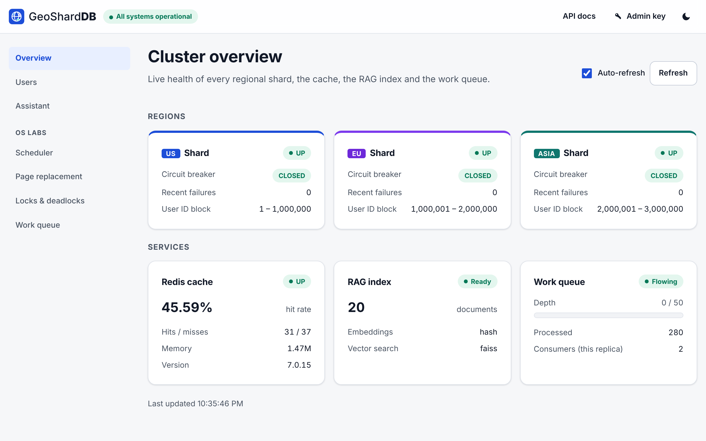

</div>

---

## Contents

- [Overview](#overview)
- [Screenshots](#screenshots)
- [Key features](#key-features)
- [Tech stack](#tech-stack)
- [Architecture](#architecture)
- [Project structure](#project-structure)
- [Prerequisites](#prerequisites)
- [Installation](#installation)
- [Configuration](#configuration)
- [Running](#running)
- [Usage](#usage)
- [Scripts and commands](#scripts-and-commands)
- [API reference](#api-reference)
- [Testing](#testing)
- [Linting, formatting and type checking](#linting-formatting-and-type-checking)
- [Deployment](#deployment)
- [Troubleshooting and FAQ](#troubleshooting-and-faq)
- [Known limitations](#known-limitations)
- [Roadmap ideas](#roadmap-ideas)
- [Contributing](#contributing)
- [License](#license)
- [Author](#author)

---

## Overview

Global products keep user data close to the user, which means **sharding by geography**. That creates hard questions: how do you route a read to the right region, keep copies in other regions, avoid hammering the database, and keep answering when a whole region goes dark?

GeoShardDB answers those questions with a small, runnable system you can poke at:

- **Three PostgreSQL shards** (US, EU, ASIA), each owning a block of user IDs.
- A **FastAPI gateway** (three replicas behind NGINX in Docker Compose) that adds Redis cache-aside, per-region circuit breakers and **failover inside the same request**.
- A **replication worker** that copies users between regions while keeping their global IDs, so a failover read returns the same person.
- A **retrieval-only RAG assistant** that answers questions from shard statistics and system notes.
- **OS-concept labs** that map classic operating-system ideas (scheduling, page replacement, mutexes, semaphores, deadlocks, bounded queues) onto distributed problems.
- A **web console** at `/console` for watching cluster health and driving every feature from a browser, on a phone or a desktop.

**Who it is for:** students and engineers learning distributed systems, interviewers and candidates who want a concrete system-design artefact, and anyone who wants to *see* failover, caching and back-pressure happen instead of reading about them.

---

## Screenshots

All screenshots were captured from a locally running instance seeded with `python seed_data.py --seed 42`. Names and emails are generated by Faker and are not real people.

| Failover during a real outage | Degraded cluster view |
|---|---|
| 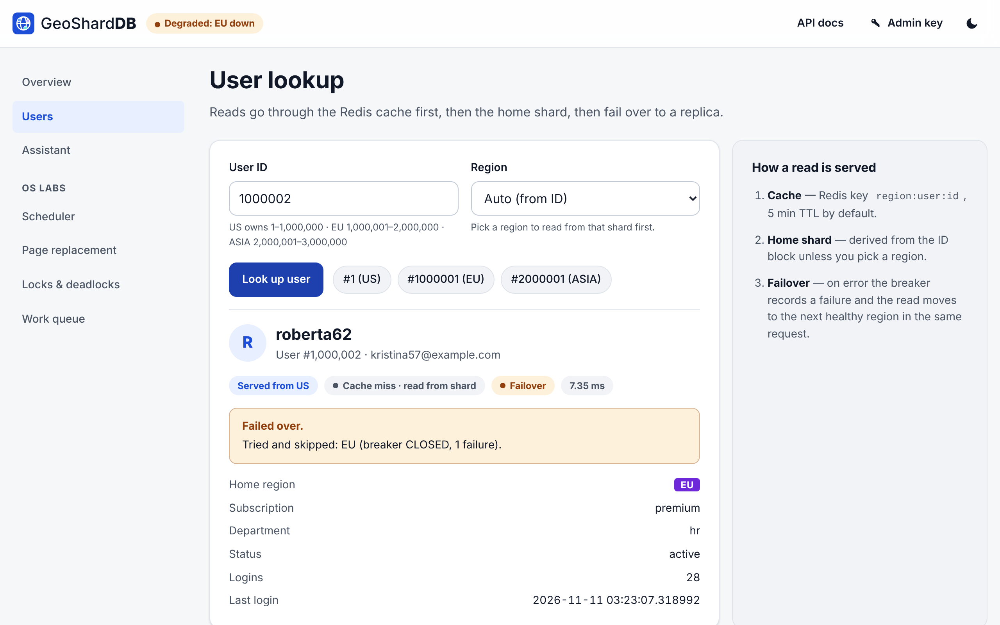 | 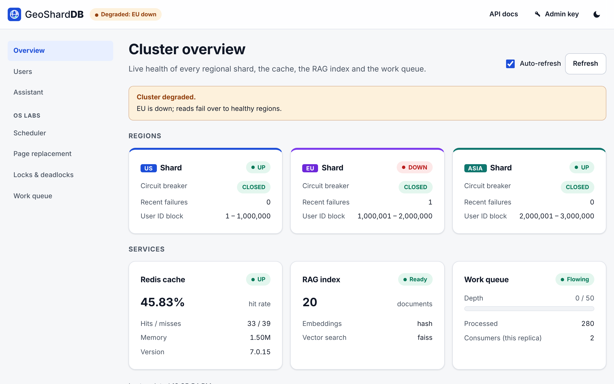 |
| The EU PostgreSQL server was stopped, the cache cleared, and EU user `1000002` looked up. The gateway recorded the EU failure and served the replica from US in the same request. | The overview polls `/health` every 10 s. The header badge and banner say which region is down. |

| User lookup (cache hit) | RAG assistant |
|---|---|
| 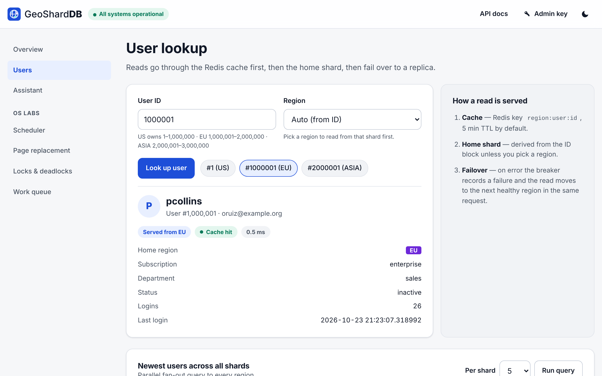 | 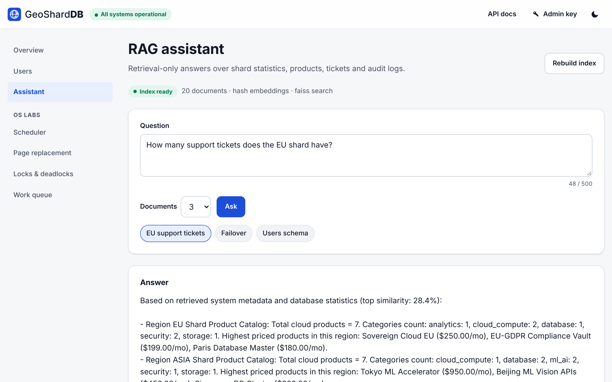 |

| Request scheduler (round robin) | Page replacement |
|---|---|
| 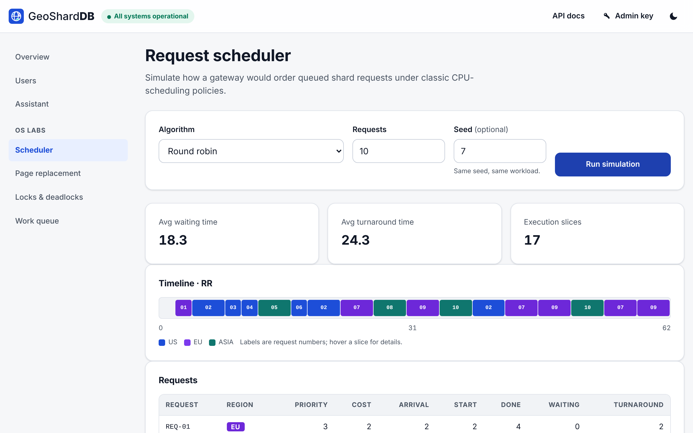 | 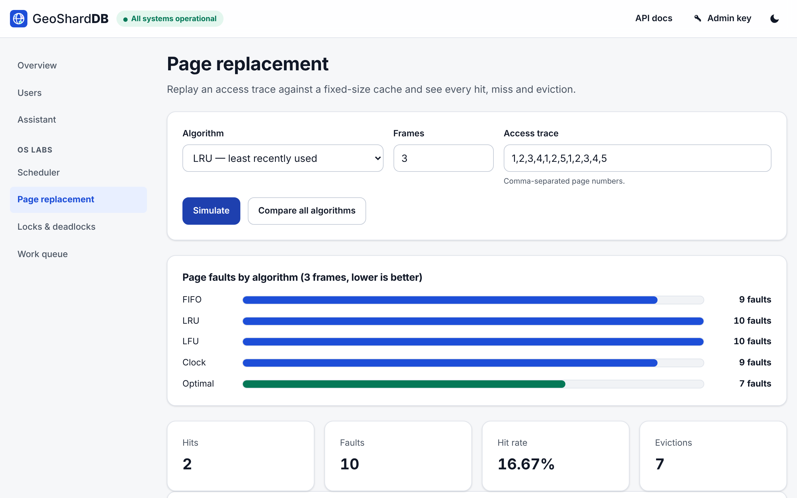 |

| Locks and deadlock detection | Work queue |
|---|---|
| 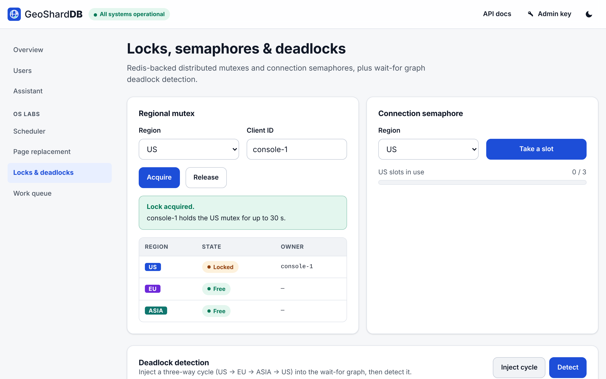 | 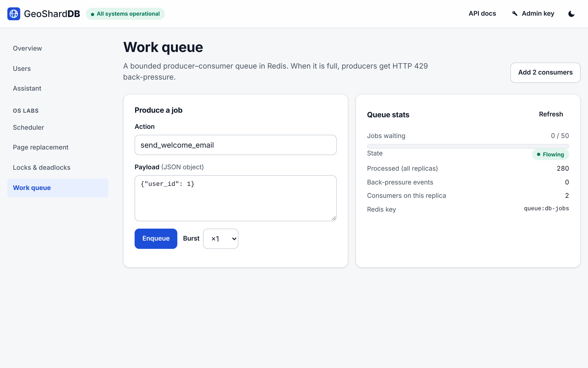 |

| Dark mode | Phone (390 px) |
|---|---|
| 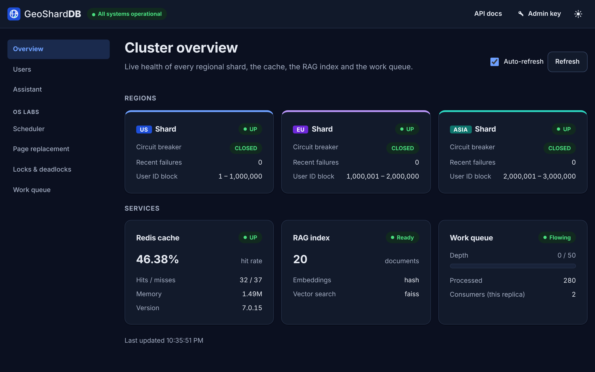 | 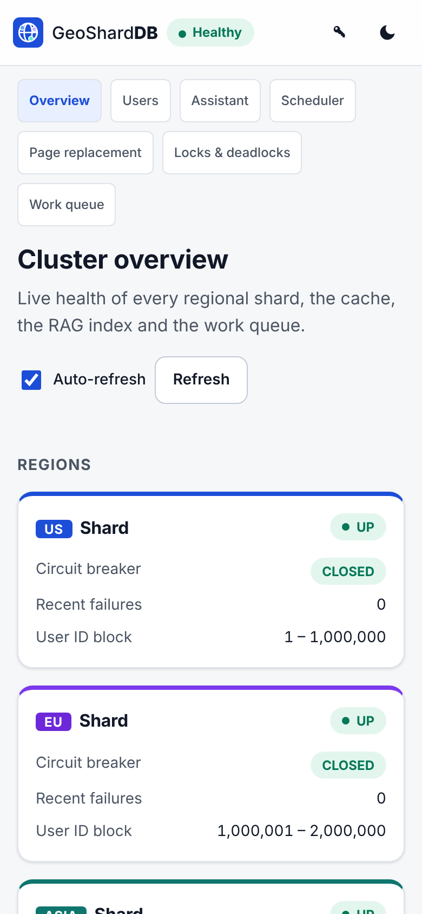 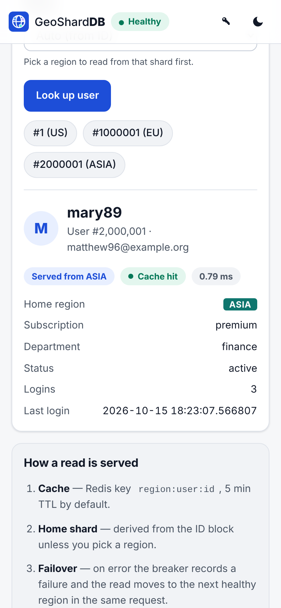 |

---

## Key features

### Distributed data

- **Geographic sharding with ID blocks.** Each region owns one million user IDs: US `1–1,000,000`, EU `1,000,001–2,000,000`, ASIA `2,000,001–3,000,000`. The home shard can be derived from the ID alone (`core/config.py`).
- **Asynchronous multi-directional replication.** `core/replication_worker.py` copies new users to the other shards with their global `user_id` (`ON CONFLICT DO NOTHING`). It marks a row replicated only after every target accepted it, so a failed pass is retried.
- **Failover inside the request.** If the home shard errors, the gateway records the failure on that region's breaker and immediately tries the next healthy region. The response lists `failed_regions`.
- **Circuit breakers.** Each region has a breaker (CLOSED → OPEN → HALF_OPEN). An open breaker is skipped without a connection attempt until the recovery timeout passes.
- **Cross-shard fan-out.** `GET /users/recent/all` queries every shard in parallel and returns partial results if one is down.
- **Cache-aside.** Redis caches `{region}:user:{id}` with a TTL. Hit/miss counters live in Redis so they are shared by all replicas. If Redis is down, reads go straight to PostgreSQL.

### Web console (`/console`)

- **Overview** of every shard (status, breaker state, failures, ID block), Redis, the RAG index and the work queue, refreshed every 10 s.
- **User lookup** that shows where each read was served from, cache hit or miss, failover and latency. Includes the parallel "newest users" fan-out table.
- **RAG assistant** with example questions, answer text and retrieved documents ranked by similarity.
- **OS labs:** scheduler with a Gantt timeline, page replacement with a step-by-step frame table and an all-algorithm comparison, mutex and semaphore controls, deadlock injection and detection, and a work-queue producer with burst mode to trigger back-pressure.
- **Light and dark themes** (follows the OS, with a toggle), responsive from 320 px phones to wide desktops, keyboard accessible (skip link, visible focus rings, labelled controls). Checked with axe-core: no WCAG 2 A/AA violations.
- Loading skeletons, empty states, friendly error messages and inline form validation everywhere. An in-app not-found view for unknown sections, plus an HTML 404 page for unknown URLs opened in a browser (API clients still get JSON).
- Plain HTML, CSS and JavaScript served by FastAPI. There is no build step, no CDN and no extra dependency.

### Platform

- NGINX load balancer in front of three API replicas (Docker Compose).
- Prometheus metrics from every replica (`/metrics`) and Grafana with the Prometheus data source pre-provisioned.
- Optional `X-API-Key` protection for admin endpoints (cache flush, RAG reindex, deadlock injection, consumer scaling).
- Kubernetes manifests and an AWS EC2 provisioning script.

### RAG assistant (retrieval-only)

- Harvests table schemas, per-shard statistics and system-behaviour notes into documents (`rag/knowledge_base.py`).
- Embeds them with `sentence-transformers` (`all-MiniLM-L6-v2`) when installed, otherwise with a deterministic feature-hashing embedding. Search uses FAISS when available, otherwise NumPy.
- Stores the index as JSON (never pickle) on a volume shared by all API replicas, which reload it when it changes.

### OS concepts mapped to distributed problems

| Endpoint | Concept |
|----------|---------|
| `GET /os/schedule` | FCFS, SJF, priority, round robin and MLFQ request scheduling |
| `GET /os/page-replacement` | FIFO, LRU, LFU, Clock and Optimal cache eviction |
| `POST /os/locks/acquire` · `/release` | Redis mutex (`SET NX PX`, owner-checked Lua release) |
| `POST /os/semaphore/acquire` · `/release` | Redis counting semaphore (atomic Lua acquire) |
| `GET /os/deadlocks` · `POST /os/deadlocks/simulate` | Wait-for-graph cycle detection shared through Redis |
| `POST /queue/produce` | Bounded producer/consumer queue with back-pressure (HTTP 429) |

---

## Tech stack

| Area | Technology |
|------|------------|
| Language | Python 3.12+ |
| API | FastAPI 0.163, Uvicorn, Pydantic |
| Web console | Semantic HTML, modern CSS (custom properties, grid, `color-mix`), vanilla ES2020 JavaScript |
| Databases | PostgreSQL 16 via psycopg2 (three shards), Redis 7 (cache, locks, queue, counters) |
| RAG | NumPy; optional sentence-transformers and FAISS |
| Demo data | Faker |
| Infrastructure | Docker, Docker Compose, NGINX, Kubernetes manifests, AWS CLI script |
| Observability | prometheus-fastapi-instrumentator, Prometheus, Grafana |
| Quality | pytest, fakeredis, Ruff (lint and format), mypy, shellcheck, GitHub Actions |

---

## Architecture

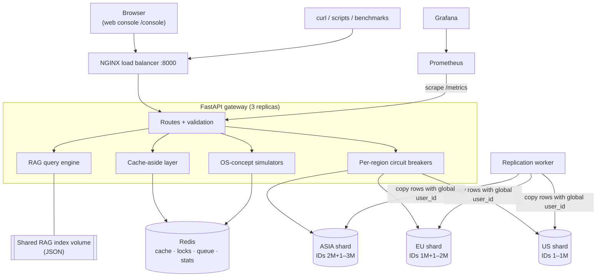

### Read path for `GET /users/{id}`

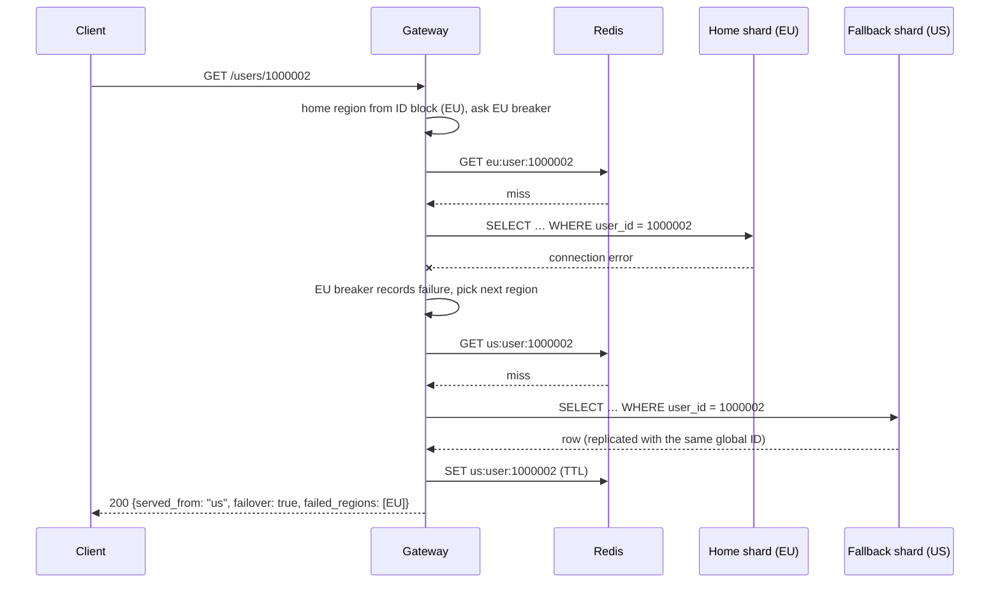

1. Pick the home region from `?region=` or from the ID block.
2. Ask that region's breaker. If it is OPEN, choose a CLOSED fallback region.
3. Check Redis, then the shard. If the shard errors, record the failure and try the next region.
4. Return the user with `served_from`, `failover`, `failed_regions`, `served_from_cache` and `latency_ms`. If every region fails, return 503.

Breakers live in each replica's memory, as client-side breakers usually do. With three replicas behind round-robin, each replica opens its own breaker after it sees the failure threshold.

---

## Project structure

```text
.
├── app.py                     # FastAPI gateway: routes, dependency wiring, lifespan, console + 404 handling
├── seed_data.py               # Region-specific demo data for every shard (CLI)
├── web/                       # Browser console served at /console (no build step)
│   ├── index.html             #   Single-page app shell: navigation, views, dialogs
│   ├── app.js                 #   Hash router, API client, views, validation, theme
│   ├── styles.css             #   Design tokens (spacing, type, colour), light/dark themes, components
│   ├── 404.html               #   HTML not-found page for browsers
│   ├── favicon.svg            #   Logo / favicon
│   └── og-image.png           #   Open Graph preview image (a real console screenshot)
├── core/
│   ├── config.py              # Env-driven settings, regions, user-ID blocks
│   ├── db.py                  # Shard connections and cursor context manager
│   ├── users.py               # User queries (point lookup, recent, ping)
│   ├── circuit_breaker.py     # Thread-safe breaker and region selection
│   ├── redis_client.py        # Shared Redis client
│   ├── redis_cache.py         # Cache-aside layer with cluster-wide stats
│   ├── replication_worker.py  # Async replication (CLI / Compose service)
│   ├── router.py              # CLI: single-shard lookup
│   └── resilient_router.py    # CLI: lookup with replica fallback
├── rag/
│   ├── embeddings.py          # sentence-transformers or hash embeddings
│   ├── vector_store.py        # FAISS/NumPy search, JSON persistence
│   ├── knowledge_base.py      # Schema, stats and system documents
│   ├── indexer.py             # Build the index (CLI)
│   └── query_engine.py        # Retrieval and hot reload
├── os_concepts/
│   ├── scheduler.py           # FCFS, SJF, priority, RR, MLFQ
│   ├── page_replacement.py    # FIFO, LRU, LFU, Clock, Optimal
│   ├── sync_primitives.py     # Redis mutex, semaphore, deadlock detector
│   ├── work_queue.py          # Bounded producer/consumer queue
│   ├── scheduling_benchmark.py
│   └── memory_benchmark.py
├── benchmarks/                # Latency, pooling, fan-out and cache benchmarks (CLIs)
├── tests/                     # pytest suite: unit, API, integration
├── db/init_schema.sql         # Schema applied to every shard
├── deploy/                    # nginx.conf, prometheus.yml, Grafana provisioning
├── k8s/                       # Kubernetes manifests (shards, Redis, API)
├── docs/screenshots/          # README screenshots
├── docker-compose.yml         # Full local stack
├── Dockerfile                 # API image (INSTALL_RAG build arg)
├── setup_aws.sh               # EC2 provisioning script
├── pyproject.toml             # Ruff, mypy and pytest configuration
├── requirements.txt           # Runtime dependencies
├── requirements-rag.txt       # Optional semantic search
├── requirements-dev.txt       # Tests and tooling
└── .env.example               # Every environment variable, with safe placeholders
```

---

## Prerequisites

| Path | You need |
|------|----------|
| Docker Compose (recommended) | Docker Engine 24+ with Compose v2, about 3 GB free disk (about 1 GB with `INSTALL_RAG=false`) |
| Local development | Python **3.12 or 3.13**, plus PostgreSQL 16 and Redis 7 (easiest from the Compose file) |
| Kubernetes (optional) | `kubectl` and a local cluster such as kind or minikube |
| AWS (optional) | AWS CLI v2 configured with credentials and a default region (or `AWS_REGION`) |

---

## Installation

### Option A: Docker Compose (full stack)

1. **Clone the repository.**

   ```bash
   git clone https://github.com/jeevithg090/Distributed_System-Geo-Sharding.git
   cd Distributed_System-Geo-Sharding
   ```

2. **Create your environment file** and set real secrets (`POSTGRES_PASSWORD` and `GRAFANA_ADMIN_PASSWORD` are required; `ADMIN_API_KEY` is strongly recommended).

   ```bash
   cp .env.example .env
   ```

3. **Build and start everything.** The default image installs CPU-only PyTorch for semantic embeddings (about 2 GB). Use `INSTALL_RAG=false` for a slim image that uses hash embeddings.

   ```bash
   docker compose up -d --build
   # or, smaller and faster:
   INSTALL_RAG=false docker compose up -d --build
   ```

4. **Wait for health checks**, then **seed demo data**:

   ```bash
   docker compose ps                              # shards, redis and api should be "healthy"
   docker compose exec api python seed_data.py    # add --seed 42 for reproducible data
   ```

   The `replication-worker` service copies the seeded users to the other shards within about 10 seconds.

5. **Build the RAG index** (needs the admin key if you set one):

   ```bash
   curl -X POST -H "X-API-Key: $ADMIN_API_KEY" localhost:8000/rag/index
   ```

6. **Open the console:** <http://localhost:8000/console>.

### Option B: Local development (Python on your machine)

```bash
python3 -m venv .venv && source .venv/bin/activate
pip install -r requirements-dev.txt          # runtime deps plus test and lint tools
# Optional semantic RAG (CPU-only torch first to avoid multi-GB CUDA wheels):
#   pip install torch --index-url https://download.pytorch.org/whl/cpu
#   pip install -r requirements-rag.txt

cp .env.example .env                         # host defaults point at localhost:5433-5435
docker compose up -d us-node eu-node asia-node redis   # just the data services

python seed_data.py --seed 42                # demo data (use --scale 0.1 for less)
python -m core.replication_worker --once     # copy users between regions
python -m rag.indexer                        # build the RAG index
uvicorn app:app --reload --port 8000         # http://localhost:8000/console
```

---

## Configuration

Every setting comes from environment variables. A local `.env` file is loaded automatically (via python-dotenv); [`.env.example`](.env.example) lists them all.

| Variable | Required? | Default | Description |
|----------|-----------|---------|-------------|
| `POSTGRES_USER` | No | `admin` | Username on all three shards |
| `POSTGRES_PASSWORD` | **Yes** for Compose | *(none)* | Password on all three shards. Compose refuses to start without it |
| `POSTGRES_DB` | No | `sharddb` | Database name on each shard |
| `SHARD_US_HOST` / `SHARD_US_PORT` | No | `localhost` / `5433` | US shard address (Compose overrides with service names) |
| `SHARD_EU_HOST` / `SHARD_EU_PORT` | No | `localhost` / `5434` | EU shard address |
| `SHARD_ASIA_HOST` / `SHARD_ASIA_PORT` | No | `localhost` / `5435` | ASIA shard address |
| `DB_CONNECT_TIMEOUT` | No | `3` | Seconds before a shard counts as unreachable |
| `REDIS_HOST` / `REDIS_PORT` | No | `localhost` / `6379` | Redis address |
| `REDIS_PASSWORD` | No | *(none)* | Redis password, if your Redis requires one |
| `ADMIN_API_KEY` | Recommended | *(unset)* | When set, admin endpoints require `X-API-Key: <value>`. When unset they are open and a warning is logged |
| `BREAKER_FAILURE_THRESHOLD` | No | `3` | Consecutive failures that open a region's breaker |
| `BREAKER_RECOVERY_TIMEOUT` | No | `15` | Seconds an open breaker waits before going half-open |
| `CACHE_TTL_SECONDS` | No | `300` | Lifetime of cached user entries |
| `RAG_EMBEDDING_BACKEND` | No | `auto` | `auto` (model if installed, else hash), `model` (require sentence-transformers) or `hash` |
| `RAG_EMBEDDING_MODEL` | No | `all-MiniLM-L6-v2` | sentence-transformers model name |
| `RAG_INDEX_PATH` | No | `data/rag_index.json` | Where the index is written and read (`/app/data/rag_index.json` in the image) |
| `LOG_LEVEL` | No | `INFO` | Python log level |
| `GRAFANA_ADMIN_USER` | No | `admin` | Grafana login (Compose only) |
| `GRAFANA_ADMIN_PASSWORD` | **Yes** for Compose | *(none)* | Grafana password (Compose only) |
| `API_URL` | No | `http://localhost:8000` | Target for `benchmarks.cache_benchmark` |
| `GEOSHARD_INTEGRATION` | No | *(unset)* | Set to `1` to run integration tests against live shards |
| `INSTALL_RAG` | No | `true` | Docker **build argument**: include torch, sentence-transformers and FAISS |

---

## Running

### Development

```bash
uvicorn app:app --reload --port 8000
```

- Console: <http://localhost:8000/console>
- Interactive API docs (Swagger UI): <http://localhost:8000/docs>
- Prometheus metrics: <http://localhost:8000/metrics>

### Production-like (Docker Compose)

```bash
docker compose up -d --build
```

| Service | URL | Notes |
|---------|-----|-------|
| Console and API (through NGINX) | <http://localhost:8000/console>, <http://localhost:8000/docs> | Three API replicas behind round-robin |
| Prometheus | <http://localhost:9090> | Bound to localhost |
| Grafana | <http://localhost:3000> | Log in with `GRAFANA_ADMIN_*` from `.env` |
| Redis Commander | <http://localhost:8081> | Opt in: `docker compose --profile tools up -d` |
| Shards | `localhost:5433` / `5434` / `5435` | US / EU / ASIA, bound to localhost |

The container runs Uvicorn as a non-root user (uid 10001) with a health check on `/`.

---

## Usage

### Web console walkthrough

1. **Overview** (`/console#/overview`). Confirm all three shards are UP and every breaker is CLOSED. The header badge summarises health on every page.
2. **Users** (`#/users`). Click an example ID such as `#1000001 (EU)`. The first lookup is a *cache miss*; look it up again and it becomes a *cache hit* with sub-millisecond latency. Click any ID in the "newest users" table to open it.
3. **Watch a failover.** Stop a shard (`docker stop eu-node`), then look up an EU user that isn't cached, for example `1000002`. The result is *Served from US* with a *Failover* badge, and the overview shows **Degraded: EU down**. Start the shard again (`docker start eu-node`) and reads return to EU after the breaker recovers.
4. **Assistant** (`#/assistant`). Ask a question or click an example. If the index isn't built, the page says so and offers **Rebuild index**.
5. **Scheduler** and **Page replacement**. Change the algorithm and inputs, run, and compare. "Compare all algorithms" runs all five eviction policies on your trace. The default trace with 3 frames reproduces Bélády's classic example.
6. **Locks & deadlocks**. Acquire a regional mutex as `console-1`, then try again with another client ID to see it refused. Click **Inject cycle**, then **Detect**, to find the Tx-1 → Tx-2 → Tx-3 cycle and the suggested victim.
7. **Work queue**. Enqueue a job, or choose burst ×60 to overflow the 50-slot queue and see HTTP 429 back-pressure.

Admin actions (Rebuild index, Inject cycle, Add consumers) need the server's `ADMIN_API_KEY` when one is configured. Click **Admin key** in the header to set it. It is kept in `sessionStorage` for the current tab only.

### API examples

All responses below were captured from a local instance seeded with `--seed 42`. Your names, emails and timings will differ.

**Health**

```bash
curl localhost:8000/health
```

```json
{
  "status": "ok",
  "shards": {
    "us":   { "status": "UP", "breaker": "CLOSED" },
    "eu":   { "status": "UP", "breaker": "CLOSED" },
    "asia": { "status": "UP", "breaker": "CLOSED" }
  },
  "redis": "UP"
}
```

**User lookup** (region derived from the ID; the second call is served from Redis)

```bash
curl localhost:8000/users/1
```

```json
{
  "user_id": 1,
  "username": "garciamichael",
  "email": "johnsonkristina@example.com",
  "region": "us",
  "subscription_type": "premium",
  "department": "engineering",
  "status": "active",
  "login_count": 25,
  "last_login": "2026-10-21 11:37:33.888200",
  "served_from": "us",
  "failover": false,
  "failed_regions": [],
  "served_from_cache": false,
  "latency_ms": 8.17
}
```

Repeating the request returned `"served_from_cache": true` with `"latency_ms": 0.44`. Unknown IDs return `404 {"detail": "User not found"}`, and an invalid region such as `?region=mars` returns `422`.

**Failover** (after `docker stop eu-node`)

```bash
curl localhost:8000/users/1000002
# → "served_from": "us", "failover": true,
#   "failed_regions": [{"region": "eu", "breaker_state": "CLOSED", "failures": 1}]
```

After three failures (`BREAKER_FAILURE_THRESHOLD`) the EU breaker opens and EU is skipped without a connection attempt.

**Page replacement**

```bash
curl "localhost:8000/os/page-replacement?algorithm=fifo&capacity=3"
```

```json
{"trace": [1,2,3,4,1,2,5,1,2,3,4,5], "capacity": 3, "algorithm": "FIFO",
 "hits": 3, "faults": 9, "hit_rate_pct": 25.0, "evictions_count": 6, "history": ["…one entry per access…"]}
```

**Scheduling**

```bash
curl "localhost:8000/os/schedule?algorithm=sjf&count=5&seed=7"
# → {"algorithm": "sjf", "avg_waiting_time": 2.6, "avg_turnaround_time": 7.0,
#    "timeline": [{"request_id": "REQ-01", "start": 2, "end": 4, "user_id": 3471, "region": "eu"}, …],
#    "requests": […]}
```

**Work queue**

```bash
curl -X POST localhost:8000/queue/produce \
     -H 'Content-Type: application/json' \
     -d '{"action": "send_welcome_email", "payload": {"user_id": 1}}'
```

```json
{"job_id": "JOB-5789805ece53", "success": true, "status": "JOB_ENQUEUED"}
```

When the queue holds 50 jobs, the same call returns `429` with `{"detail": {"job_id": "…", "status": …}}`.

**Distributed lock**

```bash
curl -X POST "localhost:8000/os/locks/acquire?region=eu&client_id=worker-7"
# → {"region":"eu","acquired":true,"client_id":"worker-7","owner":"worker-7","lock_key":"lock:mutex:eu"}
curl -X POST "localhost:8000/os/locks/release?region=eu&client_id=worker-7"
# → {"region":"eu","released":true,"client_id":"worker-7"}
```

**RAG** (admin key needed for reindexing when `ADMIN_API_KEY` is set)

```bash
curl -X POST -H "X-API-Key: $ADMIN_API_KEY" localhost:8000/rag/index
curl -X POST localhost:8000/rag/ask -H 'Content-Type: application/json' \
     -d '{"question": "How many support tickets does the EU shard have?", "top_k": 3}'
```

The response has `answer`, `retrieved_documents` (each with `text`, `similarity_score` and `metadata`) and `index_initialized`.

---

## Scripts and commands

Run these from the project root. Every CLI supports `--help`.

| Command | What it does |
|---------|--------------|
| `uvicorn app:app --reload` | Run the API and console in development mode |
| `python seed_data.py [--region R] [--scale N] [--seed N]` | Truncate and reseed shards with region-specific demo data |
| `python -m core.replication_worker [--once] [--interval S]` | Replicate new users between regions (loops by default) |
| `python -m core.router --user-id ID [--region R]` | Look up a user on one shard and print the latency |
| `python -m core.resilient_router --user-id ID [--region R]` | Look up a user with replica fallback |
| `python -m rag.indexer [--output PATH]` | Build the RAG index from the shards |
| `python -m benchmarks.benchmark -n 50 [--seed N]` | Per-shard latency, opening a new connection per query |
| `python -m benchmarks.pooled_benchmark -n 50 [--seed N]` | The same queries over a connection pool |
| `python -m benchmarks.cross_shard_query [--days N]` | Sequential vs. parallel cross-shard fan-out |
| `python -m benchmarks.cache_benchmark` | Cold (PostgreSQL) vs. warm (Redis) reads through the running API |
| `python -m os_concepts.scheduling_benchmark [--count N] [--seed N]` | Compare scheduling algorithms on one workload |
| `python -m os_concepts.memory_benchmark [--trace 1,2,3] [--capacity N]` | Compare page-replacement algorithms on one trace |
| `pytest` | Unit and API tests (integration tests skipped) |
| `GEOSHARD_INTEGRATION=1 pytest` | Also run integration tests against live shards (**truncates tables**) |
| `ruff check . && ruff format --check .` | Lint and format check |
| `mypy` | Type check |
| `docker compose up -d --build` | Start the full stack |
| `docker compose --profile tools up -d` | Also start Redis Commander |

---

## API reference

The full OpenAPI schema is at `/docs` (Swagger UI) and `/openapi.json`. **Auth:** "Admin key" means the `X-API-Key` header is required *when* `ADMIN_API_KEY` is set; everything else is open.

| Method | Path | Auth | Description |
|--------|------|------|-------------|
| GET | `/` | None | Service info, regions, links to `/docs` and `/console` |
| GET | `/health` | None | `ok` or `degraded`, each shard's status and breaker state, Redis status |
| GET | `/metrics` | None | Prometheus metrics |
| GET | `/console` | None | Web console (HTML) |
| GET | `/console/assets/{file}` | None | Console static files |
| GET | `/users/{user_id}?region=` | None | Cached, failover-aware lookup. `region` is optional (derived from the ID). 404 if missing, 503 if every region fails |
| GET | `/users/recent/all?limit=5` | None | Parallel fan-out over all shards (`limit` 1–50 per shard) |
| GET | `/breaker-status` | None | This replica's circuit breakers |
| GET | `/cache/stats` | None | Cluster-wide hit/miss counters and Redis info |
| DELETE | `/cache/{region}` | Admin key | Invalidate one region's cached users |
| DELETE | `/cache` | Admin key | Invalidate all cached users (locks and queues are kept) |
| POST | `/rag/ask` | None | Body `{"question": "...", "top_k": 3}` (question 1–500 chars, `top_k` 1–10) |
| POST | `/rag/index` | Admin key | Rebuild the index from the shards |
| GET | `/rag/status` | None | Index state, embedding backend, document count |
| GET | `/os/schedule?algorithm=&count=&seed=` | None | Scheduling simulation (`fcfs`, `sjf`, `priority`, `rr`, `mlfq`; `count` 1–100) |
| GET | `/os/page-replacement?algorithm=&capacity=&trace=` | None | Eviction simulation (`fifo`, `lru`, `lfu`, `clock`, `optimal`; `capacity` 1–64) |
| GET | `/os/locks` | None | Mutex owner per region |
| POST | `/os/locks/acquire?region=&client_id=` | None | Try to acquire a regional mutex (30 s TTL) |
| POST | `/os/locks/release?region=&client_id=` | None | Release a mutex (only the owner can) |
| GET | `/os/deadlocks` | None | Run cycle detection and return the wait-for graph |
| POST | `/os/deadlocks/simulate` | Admin key | Reset the graph and inject a US→EU→ASIA cycle |
| GET | `/os/semaphore/status?region=` | None | Active connection slots (limit 3) |
| POST | `/os/semaphore/acquire?region=&holder_id=` | None | Take a slot (held up to 30 s) |
| POST | `/os/semaphore/release?region=&holder_id=` | None | Release a slot |
| POST | `/queue/produce` | None | Body `{"action": "...", "payload": {}}`. 429 when the queue is full |
| GET | `/queue/stats` | None | Depth, capacity, processed and back-pressure counters |
| POST | `/queue/start-consumers?count=` | Admin key | Add consumer threads on the serving replica (max 8) |

Unknown paths return `404 {"detail": "Not Found"}` to API clients and an HTML 404 page to browsers (based on the `Accept` header).

---

## Testing

```bash
pytest                                   # 134 unit + API tests; 7 integration tests skip
GEOSHARD_INTEGRATION=1 pytest            # all 141 tests, needs the three shards running
```

**Unit and API tests** use `fakeredis` and an in-memory fake of the shards, so they need no services. They cover:

- breaker state transitions and in-request failover, including the 503 when every region fails;
- cache-aside hits, misses, TTLs and targeted invalidation;
- textbook page-replacement fault counts, including Bélády's anomaly;
- scheduling waiting and turnaround times for every algorithm;
- lock ownership, semaphore limits, deadlock cycles and queue back-pressure;
- RAG retrieval, index round-trips and backend-mismatch detection;
- every HTTP endpoint, input validation (422), admin-key enforcement (401);
- the console: page and assets are served, `/console/` redirects, and unknown routes return HTML to browsers and JSON to API clients.

**Integration tests** (`tests/test_integration.py`) run against real PostgreSQL. They seed data, replicate it, check that IDs match on every shard, and test failover, knowledge harvesting and the API on live shards. **They TRUNCATE the shard tables**, so point them only at disposable databases:

```bash
docker compose up -d us-node eu-node asia-node
GEOSHARD_INTEGRATION=1 pytest tests/test_integration.py
```

**Console checks.** The console was exercised end to end with Playwright at 375 px, 768 px and 1280 px in light and dark mode (no horizontal scrolling, no JavaScript errors) and audited with axe-core (no WCAG 2 A/AA violations). These browser checks are not part of the pytest suite.

The CI workflow (`.github/workflows/ci.yml`) runs Ruff, the format check, mypy and shellcheck. It also runs the full suite against three PostgreSQL service containers on Python 3.12 and 3.13, validates the Compose file, and builds and smoke-tests the Docker image.

---

## Linting, formatting and type checking

```bash
ruff check .            # lint (pycodestyle, pyflakes, isort, bugbear, pyupgrade, bandit rules and more)
ruff format .           # format (line length 110)
ruff format --check .   # verify formatting without changing files
mypy                    # type check app.py, core, os_concepts, rag, benchmarks, seed_data.py
shellcheck setup_aws.sh
```

Configuration lives in [`pyproject.toml`](pyproject.toml). The console's JavaScript and CSS have no linter configured; they are plain files with no build step.

---

## Deployment

### Single host with Docker Compose (any Linux VM)

```bash
cp .env.example .env    # set strong POSTGRES_PASSWORD, GRAFANA_ADMIN_PASSWORD and ADMIN_API_KEY
docker compose up -d --build
docker compose exec api python seed_data.py
```

Only NGINX (`:8000`) is published on all interfaces. Postgres, Redis, Prometheus and Grafana bind to `127.0.0.1`. Put TLS in front of port 8000 (for example with a reverse proxy) before exposing it to the internet.

### AWS EC2

`setup_aws.sh` creates a VPC, a public subnet and a security group, then launches an Ubuntu 22.04 instance with Docker installed. The security group opens only SSH (22) and the API (8000), and only to `ALLOWED_CIDR` (by default your current public IP). The volume is encrypted and IMDSv2 is required. The script never overwrites an existing key pair.

```bash
AWS_REGION=eu-west-1 ./setup_aws.sh
# then rsync the project (the script prints the command), create .env on the host
# and run: docker compose up -d --build
```

Reach Grafana and Prometheus through an SSH tunnel (`ssh -L 3000:localhost:3000 …`); they are not exposed publicly.

### Kubernetes

The manifests in `k8s/` deploy three shards, Redis and the API (NodePort `30080`). Credentials come from a Secret:

```bash
kubectl create secret generic geoshard-db \
  --from-literal=POSTGRES_USER=admin \
  --from-literal=POSTGRES_PASSWORD="$(openssl rand -hex 16)" \
  --from-literal=ADMIN_API_KEY="$(openssl rand -hex 16)"
kubectl create configmap geoshard-schema --from-file=db/init_schema.sql
docker build -t geoshard-api:latest .      # then load it into your cluster (kind/minikube)
kubectl apply -f k8s/
kubectl exec deploy/geoshard-api -- python seed_data.py
```

The manifests are examples for a local cluster: the shards have no persistent volumes, and the API runs one replica because its RAG index is on pod-local disk.

---

## Troubleshooting and FAQ

| Symptom | Cause and fix |
|---------|---------------|
| `required variable POSTGRES_PASSWORD is missing` | No `.env`. Run `cp .env.example .env` and set the secrets |
| `/users/1` returns 404, or the console says "No user found" | The shards are empty. Run `python seed_data.py` (or `docker compose exec api python seed_data.py`) |
| A user exists on its home shard but failover returns 404 | Replication hasn't run yet. Wait about 10 s for the worker, or run `python -m core.replication_worker --once` |
| Console header says **API unreachable** | The API process is down or the page was opened from another origin. Open the console from the API's own URL (`/console`) |
| Admin buttons show "needs the admin API key" | `ADMIN_API_KEY` is set on the server. Click **Admin key** in the header and paste it |
| `/rag/ask` says the index is not initialized | Run `POST /rag/index` (with `X-API-Key`) or `python -m rag.indexer` |
| `/rag/ask` reports an embedding backend mismatch | The index was built with another backend. Rebuild it |
| RAG answers look only loosely related | Without sentence-transformers the hash-embedding fallback matches on shared words, not meaning. Install `requirements-rag.txt` (or build with `INSTALL_RAG=true`) and rebuild the index |
| Overview numbers (breakers, consumers) change between refreshes in Compose | Each refresh can hit a different API replica. Breakers and consumer threads are per replica by design; cache, queue, lock and deadlock data are shared in Redis |
| Changed `db/init_schema.sql` but nothing happened | Postgres only runs init scripts on an empty volume. Run `docker compose down -v` (this deletes data) |
| Seeding one region left stale replicas elsewhere | Re-seed all regions, or truncate the other shards before replicating |
| Docker build is very slow or huge | The default build installs PyTorch. Use `INSTALL_RAG=false` |
| `ModuleNotFoundError` when running a script | Run from the project root as a module: `python -m benchmarks.benchmark`, not `python benchmarks/benchmark.py` |

**Is this production software?** No. It is a learning and demonstration project. The patterns are real, but there is no authentication beyond the optional admin key, and the infrastructure files are starting points.

**Why are breakers per replica?** Client-side breakers usually are: each caller protects itself. Making them shared (in Redis) is listed under roadmap ideas.

**Can I use the console on my phone?** Yes. It is responsive down to 320 px with touch-sized controls.

---

## Known limitations

- **Breakers and consumer threads are per replica.** Behind the load balancer, the console overview can show different breaker states from one refresh to the next.
- **The hash-embedding fallback is lexical**, so RAG answers are approximate unless sentence-transformers is installed. The RAG assistant only retrieves documents; it does not generate prose.
- **Replication is asynchronous and insert-only.** Updates and deletes after the first copy are not propagated, and a replica may briefly lag its home shard.
- **The console has no login.** Anyone who can reach the API can use the non-admin features; admin actions rely on `ADMIN_API_KEY`.
- **Kubernetes manifests** have no persistent volumes and run a single API replica.
- **No automated browser tests in CI.** The console was verified manually with Playwright and axe-core.
- The full image with `INSTALL_RAG=true` (torch and sentence-transformers) was not rebuilt during the latest round of changes.

---

## Roadmap ideas

- Redis-backed shared circuit breakers across replicas.
- Propagate updates and deletes in replication (for example with logical replication or change data capture).
- Persistent volumes and a shared index volume for Kubernetes; a Helm chart.
- Grafana dashboards for request latency, cache hit rate and breaker transitions.
- A latency-injection control in the console (wrapping `tc netem`) to simulate slow regions.
- Playwright smoke tests for the console in CI.
- Optional LLM answer generation on top of retrieval.

---

## Contributing

Contributions are welcome.

1. Fork the repository and create a branch: `git checkout -b feat/my-change`.
2. Set up the dev environment ([Option B](#option-b-local-development-python-on-your-machine)).
3. Make your change with tests. Keep the console dependency-free (plain HTML, CSS and JS).
4. Run the checks before opening a pull request:

   ```bash
   ruff check . && ruff format --check . && mypy && pytest
   ```

5. Use [Conventional Commits](https://www.conventionalcommits.org/) (`feat:`, `fix:`, `docs:` …) and describe how you verified the change.

Please open an issue first for large changes so the approach can be discussed.

---

## License

This repository does not include a license file yet, so by default all rights are reserved by the author. If you want others to reuse the code, adding a permissive license such as **MIT** or **Apache-2.0** is recommended.

---

## Author

Built by [jeevithg090](https://github.com/jeevithg090) to explore how globally distributed databases and cloud-native backends behave across regions.
