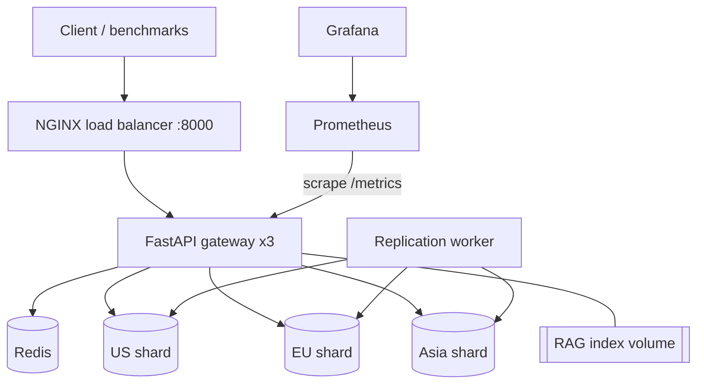

# GeoShardDB

A hands-on **multi-region distributed database simulator**. It shows how a global backend shards data by geography, routes reads, replicates between regions, caches hot paths and keeps serving when a region goes down.

Three PostgreSQL shards (US, EU, Asia) sit behind a horizontally scaled **FastAPI** gateway. The gateway adds **Redis** cache-aside, per-region **circuit breakers** with failover inside the same request, **Prometheus** metrics, a retrieval-only **RAG** assistant over shard metadata, and interactive **OS concept** demos: scheduling, page replacement, distributed locks and semaphores, deadlock detection, and a bounded work queue.

---

## Features

**Distributed data**

- **Geographic sharding.** Each user lives on their home region's shard. Every region owns a block of one million user IDs (US `1…`, EU `1,000,001…`, Asia `2,000,001…`), so the home shard can be worked out from the ID alone.
- **Asynchronous multi-directional replication.** A worker copies new rows, keeping their global `user_id`, to the other shards. A row is marked replicated only after every target accepts it, so a failed pass is retried.
- **Failover reads.** When a shard errors, the gateway records the failure and serves the read from another region's replica during the same request. Each region has a breaker (CLOSED → OPEN → HALF-OPEN); while it is open, the gateway skips that region without trying it.
- **Cross-shard fan-out.** `GET /users/recent/all` queries all shards in parallel and returns partial results if one is down.
- **Cache-aside.** Redis caches `{region}:user:{id}` with a configurable TTL. Hit and miss counters are stored in Redis, so stats cover every replica. When Redis is down, reads fall through to PostgreSQL.

**Platform**

- NGINX load balancer in front of 3 API replicas (Docker Compose).
- Prometheus scraping every replica, plus Grafana with the Prometheus data source pre-provisioned.
- Optional `X-API-Key` protection for admin endpoints (cache flush, RAG reindex, deadlock injection, consumer scaling).
- Kubernetes manifests and an AWS EC2 provisioning script.

**RAG assistant (retrieval-only)**

- Harvests table schemas, per-shard statistics and system-behaviour notes into documents.
- Embeds them with `sentence-transformers` (`all-MiniLM-L6-v2`), or, if that is not installed, with a deterministic feature-hashing embedding. Search uses FAISS when available, otherwise NumPy.
- Saves the index as JSON (never pickle) on a volume shared by all API replicas, which hot-reload it when it changes.

**OS concepts mapped to distributed problems**

| Endpoint | Concept |
|----------|---------|
| `GET /os/schedule` | FCFS, SJF, priority, round robin, MLFQ request scheduling |
| `GET /os/page-replacement` | FIFO, LRU, LFU, Clock, Optimal cache eviction |
| `POST /os/locks/acquire` · `/release` | Redis mutex (`SET NX PX` and owner-checked Lua release) |
| `POST /os/semaphore/acquire` · `/release` | Redis counting semaphore (atomic Lua acquire) |
| `GET /os/deadlocks` · `POST /os/deadlocks/simulate` | Wait-for-graph cycle detection, shared through Redis |
| `POST /queue/produce` | Bounded producer/consumer queue with back-pressure (HTTP 429) |

---

## Architecture



**Read path for `GET /users/{id}`**

1. Pick the home region from `?region=` or from the ID block.
2. Ask that region's breaker. If it is OPEN, choose a CLOSED fallback region.
3. Check Redis, then the shard. If the shard errors, record the failure and try the next region.
4. Return the user with `served_from`, `failover`, `failed_regions`, `served_from_cache` and `latency_ms`.

Breakers are kept in each replica's memory, as client-side breakers usually are. With three replicas behind round-robin, every replica opens its own breaker after it sees the failure threshold.

---

## Tech stack

| Area | Technology |
|------|------------|
| API | Python 3.11+, FastAPI, Uvicorn, Pydantic |
| Data | PostgreSQL 16 (psycopg2), Redis 7 |
| RAG | NumPy; optional sentence-transformers and FAISS |
| Infra | Docker Compose, NGINX, Kubernetes manifests, AWS CLI script |
| Observability | prometheus-fastapi-instrumentator, Prometheus, Grafana |
| Quality | pytest, fakeredis, Ruff (lint and format), mypy, GitHub Actions |

---

## Quick start (Docker Compose)

Requires Docker with Compose v2. The default image installs CPU-only PyTorch for semantic embeddings (about 2 GB). Set `INSTALL_RAG=false` for a slim image that uses hash embeddings.

```bash
git clone https://github.com/jeevithg090/Distributed_System-Geo-Sharding.git
cd Distributed_System-Geo-Sharding

cp .env.example .env          # then set POSTGRES_PASSWORD, GRAFANA_ADMIN_PASSWORD, ADMIN_API_KEY
docker compose up -d --build  # or: INSTALL_RAG=false docker compose up -d --build
docker compose ps             # wait for the shards, redis and api to be healthy

docker compose exec api python seed_data.py   # load demo data into every shard
```

The `replication-worker` service starts copying the seeded users between shards within about 10 seconds.

| Service | URL | Notes |
|---------|-----|-------|
| API (through NGINX) | http://localhost:8000 | interactive docs at `/docs` |
| Prometheus | http://localhost:9090 | bound to localhost |
| Grafana | http://localhost:3000 | log in with `GRAFANA_ADMIN_*` from `.env` |
| Redis Commander | http://localhost:8081 | opt in: `docker compose --profile tools up -d` |
| Shards | `localhost:5433` / `5434` / `5435` | US / EU / Asia, bound to localhost |

### Try it

```bash
curl localhost:8000/health
curl localhost:8000/users/1                 # US user, region derived from the ID
curl "localhost:8000/users/1000001?region=eu"
curl localhost:8000/users/recent/all
curl localhost:8000/cache/stats

# Admin endpoints need the key when ADMIN_API_KEY is set
curl -X POST -H "X-API-Key: $ADMIN_API_KEY" localhost:8000/rag/index
curl -X POST localhost:8000/rag/ask -H 'Content-Type: application/json' \
     -d '{"question": "Which region has the most billing tickets?"}'
```

### Fault-injection demo

```bash
docker stop eu-node
curl localhost:8000/users/1000002      # served_from: "us", failed_regions lists EU
curl localhost:8000/health             # status: "degraded", EU DOWN
docker start eu-node                   # breakers half-open, then close again
```

Shard containers have `NET_ADMIN`, so you can add latency between "regions" by hand, for example `docker exec eu-node tc qdisc add dev eth0 root netem delay 80ms`. This needs `iproute2` inside the container.

---

## Local development

```bash
python3 -m venv .venv && source .venv/bin/activate
pip install -r requirements-dev.txt          # runtime deps plus test and lint tools
# optional semantic RAG:
#   pip install torch --index-url https://download.pytorch.org/whl/cpu && pip install -r requirements-rag.txt

cp .env.example .env                         # host defaults point at localhost:5433-5435
docker compose up -d us-node eu-node asia-node redis

python seed_data.py                          # --scale 0.1 --seed 42 for small, reproducible data
uvicorn app:app --reload --port 8000
```

### CLIs and benchmarks

Run these from the project root as modules:

```bash
python -m core.router --user-id 1000001                 # single-shard lookup with latency
python -m core.resilient_router --user-id 1 --region us # lookup that falls back to replicas
python -m core.replication_worker --once                # one replication pass (omit --once to loop)
python -m rag.indexer                                   # rebuild the RAG index

python -m benchmarks.benchmark -n 50          # per-shard latency, a new connection each query
python -m benchmarks.pooled_benchmark -n 50   # same queries over a connection pool
python -m benchmarks.cross_shard_query        # sequential vs. parallel fan-out
python -m benchmarks.cache_benchmark          # cold vs. warm reads through the running API

python -m os_concepts.scheduling_benchmark --seed 1
python -m os_concepts.memory_benchmark
```

---

## Configuration

Every setting comes from environment variables. A local `.env` file is loaded automatically; see [`.env.example`](.env.example).

| Variable | Default | Purpose |
|----------|---------|---------|
| `POSTGRES_USER` / `POSTGRES_PASSWORD` / `POSTGRES_DB` | `admin` / *(none)* / `sharddb` | Shard credentials (Compose requires a password) |
| `SHARD_{US,EU,ASIA}_HOST` / `_PORT` | `localhost` / `5433`, `5434`, `5435` | Shard addresses |
| `DB_CONNECT_TIMEOUT` | `3` | Seconds before a shard counts as unreachable |
| `REDIS_HOST` / `REDIS_PORT` / `REDIS_PASSWORD` | `localhost` / `6379` / *(none)* | Redis connection |
| `ADMIN_API_KEY` | *(unset)* | If set, admin endpoints require `X-API-Key` |
| `BREAKER_FAILURE_THRESHOLD` | `3` | Consecutive failures that open a breaker |
| `BREAKER_RECOVERY_TIMEOUT` | `15` | Seconds before an open breaker goes half-open |
| `CACHE_TTL_SECONDS` | `300` | Cache entry lifetime |
| `RAG_EMBEDDING_BACKEND` | `auto` | `auto`, `model` (requires sentence-transformers) or `hash` |
| `RAG_EMBEDDING_MODEL` | `all-MiniLM-L6-v2` | sentence-transformers model name |
| `RAG_INDEX_PATH` | `data/rag_index.json` | Where the index is written and read |
| `LOG_LEVEL` | `INFO` | Python log level |
| `GRAFANA_ADMIN_USER` / `GRAFANA_ADMIN_PASSWORD` | `admin` / *(none)* | Grafana login (Compose only) |
| `INSTALL_RAG` | `true` | Docker build argument: include torch, sentence-transformers and FAISS |

---

## API reference

Full OpenAPI schema: `http://localhost:8000/docs`. 🔒 marks endpoints that need `X-API-Key` when `ADMIN_API_KEY` is set.

| Method | Path | Description |
|--------|------|-------------|
| GET | `/` | Service info |
| GET | `/health` | `ok` or `degraded`, with each shard's status, breaker state and Redis status |
| GET | `/metrics` | Prometheus metrics |
| GET | `/users/{user_id}?region=` | Cached, failover-aware lookup (`region` optional). Returns 404 if missing, 503 if every region fails |
| GET | `/users/recent/all?limit=5` | Parallel fan-out over all shards |
| GET | `/breaker-status` | This replica's circuit breakers |
| GET | `/cache/stats` | Cluster-wide hit and miss counters, Redis info |
| DELETE 🔒 | `/cache/{region}`, `/cache` | Invalidate one region's cached users, or all of them (locks and queues are kept) |
| POST | `/rag/ask` | `{"question": "...", "top_k": 3}` |
| POST 🔒 | `/rag/index` | Rebuild the index from the shards |
| GET | `/rag/status` | Index state, backend and document count |
| GET | `/os/schedule?algorithm=fcfs&count=10&seed=` | Scheduling simulation |
| GET | `/os/page-replacement?algorithm=lru&capacity=4&trace=1,2,3` | Eviction simulation |
| GET | `/os/locks` | Mutex owners per region |
| POST | `/os/locks/acquire`, `/os/locks/release` `?region=&client_id=` | Acquire or release a lock (only the owner can release) |
| GET | `/os/deadlocks` | Run cycle detection and return the wait-for graph |
| POST 🔒 | `/os/deadlocks/simulate` | Reset the graph and inject a US→EU→Asia cycle |
| GET / POST | `/os/semaphore/status`, `/acquire`, `/release` | Per-region connection slots (limit 3) |
| POST | `/queue/produce` | `{"action": "...", "payload": {}}`. Returns 429 when the queue is full |
| GET | `/queue/stats` | Depth, processed and back-pressure counters |
| POST 🔒 | `/queue/start-consumers?count=` | Add consumer threads on the replica that serves the request (up to 8) |

---

## Testing and quality

```bash
ruff check . && ruff format --check .   # lint and format
mypy                                    # type-check
pytest                                  # unit and API tests (integration tests are skipped)
```

Unit and API tests use `fakeredis` and an in-memory fake of the shards, so they need no services. They cover breaker state transitions and failover, cache-aside, textbook page-replacement fault counts (including Bélády's anomaly), scheduling waiting times, lock ownership, semaphore limits, deadlock cycles, queue back-pressure, RAG retrieval, index round-trips, and every HTTP endpoint.

The integration tests (`tests/test_integration.py`) run against real PostgreSQL. They seed data, replicate it, check that IDs match on every shard, and test failover, knowledge harvesting and the API on live shards. **They TRUNCATE the shard tables**, so only point them at disposable databases:

```bash
docker compose up -d us-node eu-node asia-node
GEOSHARD_INTEGRATION=1 pytest tests/test_integration.py
```

CI (`.github/workflows/ci.yml`) runs lint, format, mypy and shellcheck. It also runs the full test suite against three PostgreSQL service containers on Python 3.11, 3.12 and 3.13, validates the Compose file, and builds and smoke-tests the Docker image.

---

## Deployment

### Single host (AWS EC2)

`setup_aws.sh` creates a VPC, a public subnet and a security group, then launches an Ubuntu 22.04 instance with Docker installed. The security group opens only SSH (22) and the API (8000), and only to `ALLOWED_CIDR` (by default your current public IP). The AMI is looked up from Canonical's SSM parameter for your region. The script will not overwrite an existing key pair.

```bash
AWS_REGION=eu-west-1 ./setup_aws.sh
# then rsync the project (the script prints the command), create .env on the host and run docker compose up -d --build
```

Reach Grafana and Prometheus through an SSH tunnel; they are not exposed publicly.

### Kubernetes

The manifests in `k8s/` deploy three shards, Redis and the API (NodePort `30080`). Credentials come from a Secret:

```bash
kubectl create secret generic geoshard-db \
  --from-literal=POSTGRES_USER=admin \
  --from-literal=POSTGRES_PASSWORD="$(openssl rand -hex 16)" \
  --from-literal=ADMIN_API_KEY="$(openssl rand -hex 16)"
kubectl create configmap geoshard-schema --from-file=db/init_schema.sql
docker build -t geoshard-api:latest .      # then load it into your cluster (kind/minikube)
kubectl apply -f k8s/
kubectl exec deploy/geoshard-api -- python seed_data.py
```

The manifests are examples for a local cluster. The shards have no persistent volumes, and the API runs one replica because its RAG index is on pod-local disk.

---

## Project structure

```text
├── app.py                     # FastAPI gateway (routes, dependency wiring, lifespan)
├── seed_data.py               # Region-specific demo data for every shard
├── core/
│   ├── config.py              # Env-driven settings, regions, user-ID blocks
│   ├── db.py                  # Shard connections and cursor context manager
│   ├── users.py               # User queries (point lookup, recent, ping)
│   ├── circuit_breaker.py     # Thread-safe breaker and region selection
│   ├── redis_client.py        # Shared Redis client
│   ├── redis_cache.py         # Cache-aside layer with cluster-wide stats
│   ├── replication_worker.py  # Async replication (CLI/service)
│   ├── router.py              # CLI: single-shard lookup
│   └── resilient_router.py    # CLI: lookup with replica fallback
├── rag/
│   ├── embeddings.py          # sentence-transformers or hash embeddings
│   ├── vector_store.py        # FAISS/NumPy search, JSON persistence
│   ├── knowledge_base.py      # Schema, stats and system documents
│   ├── indexer.py             # Build the index (CLI)
│   └── query_engine.py        # Retrieval and hot-reload
├── os_concepts/               # Scheduler, page replacement, sync primitives, work queue, benchmarks
├── benchmarks/                # Latency, pooling, fan-out and cache benchmarks
├── tests/                     # pytest suite (unit, API, integration)
├── db/init_schema.sql         # Schema applied to every shard
├── deploy/                    # nginx.conf, prometheus.yml, Grafana provisioning
├── k8s/                       # Kubernetes manifests
├── docker-compose.yml · Dockerfile · setup_aws.sh
├── requirements.txt           # runtime
├── requirements-rag.txt       # optional semantic search
└── requirements-dev.txt       # tests and tooling
```

---

## Troubleshooting

| Symptom | Fix |
|---------|-----|
| `required variable POSTGRES_PASSWORD is missing` | Run `cp .env.example .env` and set the secrets |
| Empty results or 404 for `/users/1` | Seed the shards: `docker compose exec api python seed_data.py` |
| `/rag/ask` says the index is not initialized | `POST /rag/index` (with `X-API-Key`) or `python -m rag.indexer` |
| `/rag/ask` reports an embedding backend mismatch | The index was built with another backend; rebuild it |
| Changed `db/init_schema.sql` but nothing happened | Postgres runs init scripts only on an empty volume: `docker compose down -v` |
| Seeding one region left stale replicas elsewhere | Re-seed all regions, or truncate the other shards before replicating |

---

## Author

Built by [jeevithg090](https://github.com/jeevithg090) to explore how globally distributed databases and cloud-native backends behave across regions.
